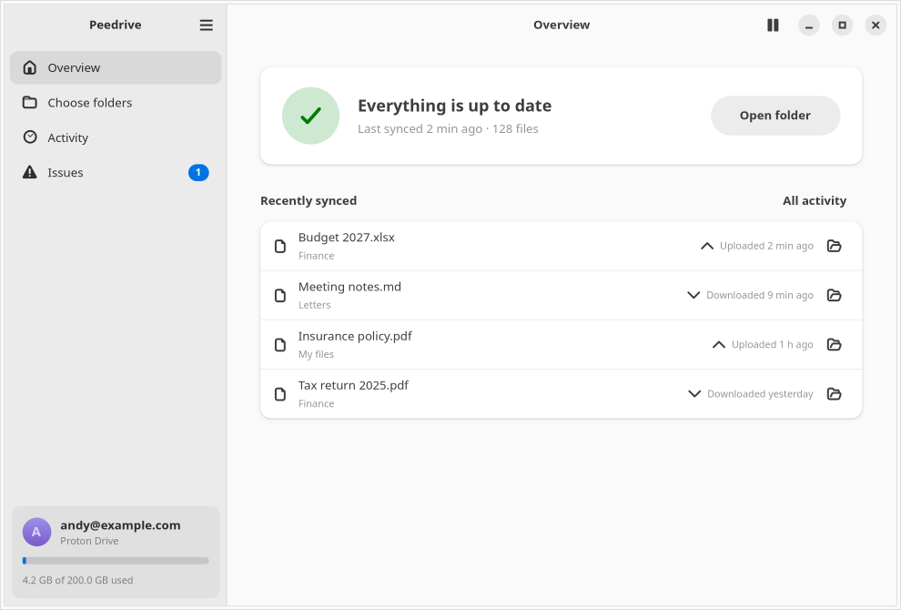
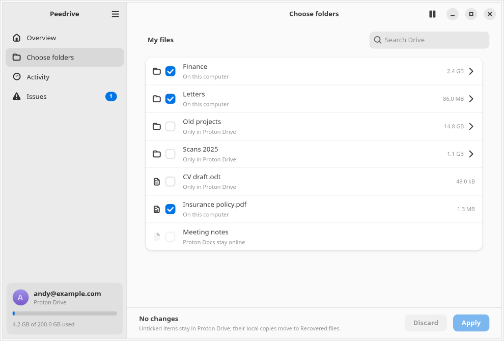
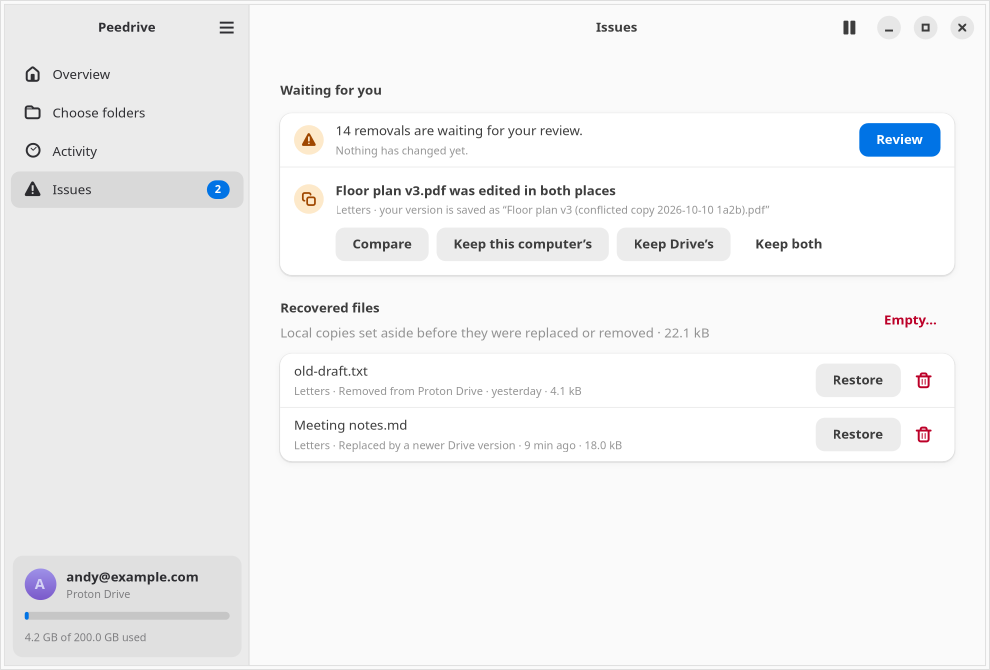
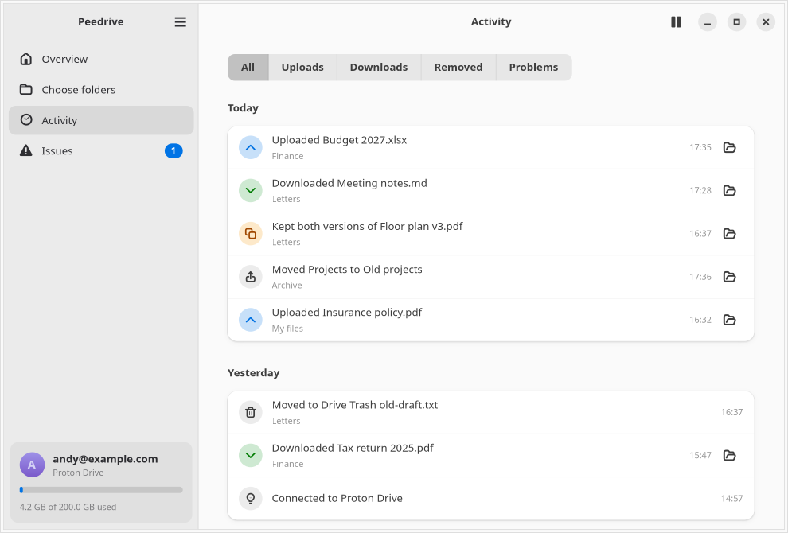
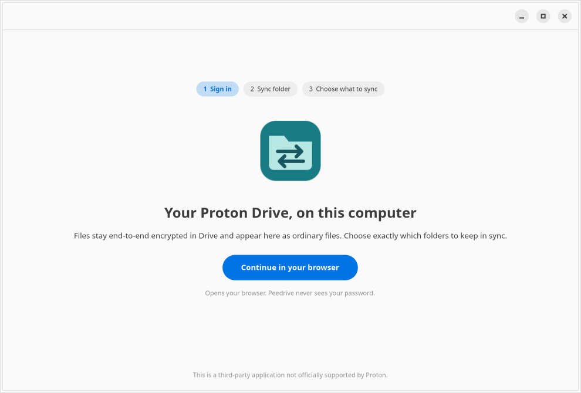

# Peedrive

A native GNOME client for browsing Proton Drive and choosing which files and
folders to sync locally. One Proton account and one local sync folder. The sync engine and app are Rust. A persistent Bun helper uses Proton's
official TypeScript SDK for encrypted Drive operations and browser sign-in.

This is a personal-use alpha. Saved-session restoration and dedicated-folder
Proton transfer/conflict checks have passed on the target machine. The local
engine, SDK adapter, and service also have automated tests.



 
 

Screenshots use synthetic data. `scripts/check-ui.sh` regenerates them in `dist/`.

## Build on Ubuntu 26.04

Install Rust through rustup and Bun 1.4.2. Rust is pinned by rust-toolchain.toml.
Then install native dependencies:

```sh
sudo apt install build-essential pkg-config libgtk-4-dev libadwaita-1-dev \
  libsecret-1-dev python3-gi gir1.2-ayatanaappindicator3-0.1 python3-nautilus \
  xvfb dbus-x11
sh scripts/bootstrap-sdk.sh
sh scripts/build.sh
sh scripts/package-deb.sh
```

The SDK bootstrap checks out commit
`8ffae007b0fbb8bcef53514719d6f093bb32dcf9`. Cargo.lock and bun.lock pin the
remaining dependencies. The compiled helper embeds Bun, so users of the Debian
or Arch package do not need a JavaScript runtime installed.

## Build on Arch Linux

Install Bun 1.4.2 (for example `curl -fsSL https://bun.sh/install | bash -s
bun-v1.4.2`), then open a new terminal or run `exec zsh` so `bun` is on your
PATH. The `rustup` package picks up the toolchain pinned by
rust-toolchain.toml. Then:

```sh
sudo pacman -S --needed base-devel rustup git gtk4 libadwaita libsecret \
  python-gobject gtk3 libayatana-appindicator nautilus-python xorg-server-xvfb
sh scripts/bootstrap-sdk.sh
sh scripts/build.sh
sh scripts/package-arch.sh
```

## Install and run

On Ubuntu:

```sh
sudo apt install ./dist/peedrive_0.1.0~alpha9_amd64.deb
```

On Arch Linux:

```sh
sudo pacman -U dist/peedrive-0.1.0alpha9-1-x86_64.pkg.tar.zst
```

Then on either:

```sh
systemctl --user daemon-reload
systemctl --user enable --now peedrive.service
systemctl --user enable --now peedrive-indicator.service
peedrive-app
```

Sign in through your browser first, then choose the local folder (the
suggestion is `~/Proton Drive`). Choose folders lists My files with folder
sizes and search; tick what should live on this computer and Apply. Additions
apply straight away; a review appears only when something would be removed or
was edited in both places. Unticking stops syncing an item and moves its local
copy to Recovered files; Proton Drive is not changed.

Overview shows what is happening and what to do about it. Activity lists every
upload, download and removal by day. Issues gathers conflicts (compare, keep
either version or both), held removals, stopped syncs and recovered files,
which are kept until you restore or delete them unless Preferences sets 30 or
90 days. Preferences also moves the sync folder, edits exclusions, and controls
start at login, the top-bar indicator, notifications and pausing on metered
connections. Closing the window leaves the service running. GNOME's
AppIndicator extension is needed for the optional indicator. Nautilus loads its
optional extension on its next restart or login.

For development, run `target/debug/peedrive daemon` in one terminal and
`target/debug/peedrive-app` in another after `cargo build --features gui` and
`bun run build:adapter`. Set `PEEDRIVE_ADAPTER` to override the helper executable
or `PEEDRIVE_DATA_DIR` to isolate the app's state. Neither changes the service's
Proton endpoints or its GNOME Keyring credential entry.

## Command-line controls

```sh
peedrive setup '~/Peedrive/{account email}/Proton Drive'
peedrive login
peedrive status
peedrive browse
peedrive select-drive Documents 'notes.txt'
peedrive preview MAPPING_ID
peedrive approve MAPPING_ID
peedrive pause MAPPING_ID
peedrive resume MAPPING_ID
peedrive ignore MAPPING_ID '**/node_modules' '**/*.tmp'
peedrive remove MAPPING_ID
```

`remove` disconnects a mapping and keeps both copies. `ignore` replaces the
mapping's ignore list, keeps existing files, and requires a fresh preview.
Ordinary pause/resume keeps an approved mapping approved. An interrupted or
failed write requires a fresh review before further changes.

After sign-in, `peedrive live-test` creates a unique folder named
`Peedrive integration test ...` in My files. It checks upload, verified download,
remote revision updates, simultaneous edits, conflict-copy upload, and a
generated file's deletion to Drive Trash. It leaves the test mapping paused
and writes a JSON report under the state directory's `live-tests/` folder.
It does not use an existing sync mapping.

## Where files and credentials live

The default state directory is `$XDG_DATA_HOME/peedrive`, normally
`~/.local/share/peedrive`, with owner-only access. It contains the sync baseline,
operation journal and activity history. Local path metadata is not encrypted.
SDK crypto caches and the remote index encrypt their values using a key stored
in GNOME Keyring alongside the account session. There is no plaintext credential
fallback. App telemetry is disabled.

Local files remain ordinary decrypted files. Replaced or remotely deleted local
files go under `.peedrive-recovery/` in their sync folder. Interrupted transfer
staging is under `.peedrive-tmp/`. These directories never sync. Recovery copies
are listed under Issues › Recovered files, where you can restore or delete them.

Peedrive is an unofficial third-party client, not supported by Proton. It uses
its own application identifier and no Proton branding. Proton's current SDK
guidelines and anticipated cryptographic migration are linked in
[THIRD_PARTY.md](THIRD_PARTY.md).
